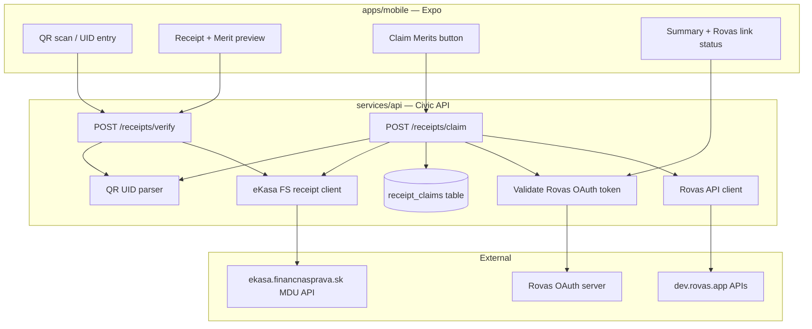
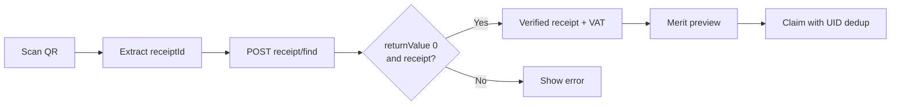
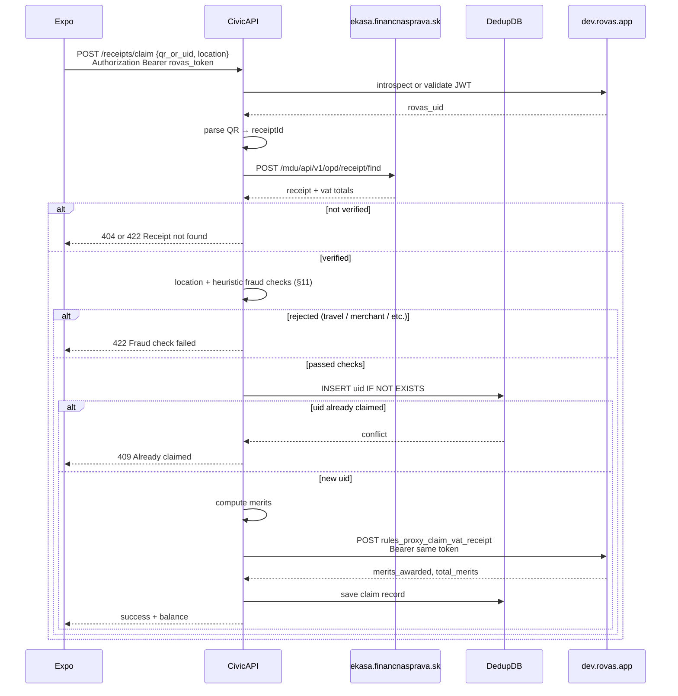
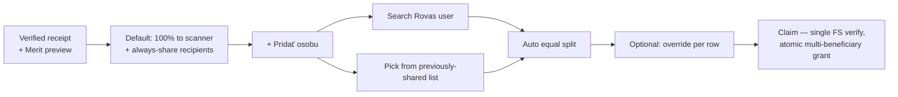
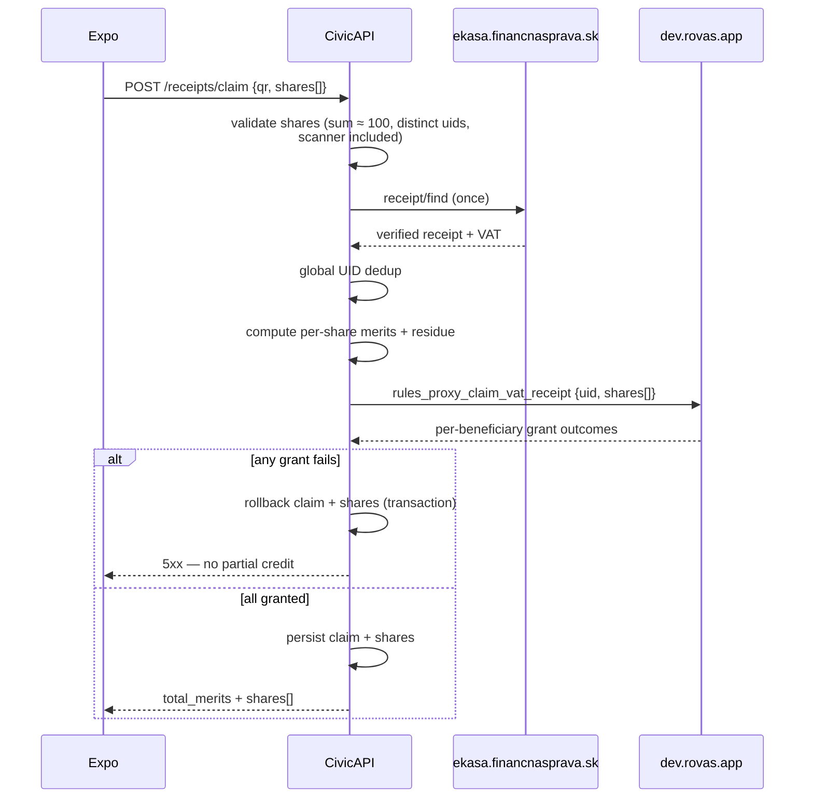
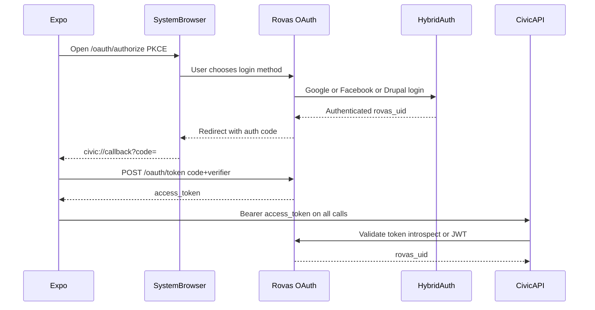
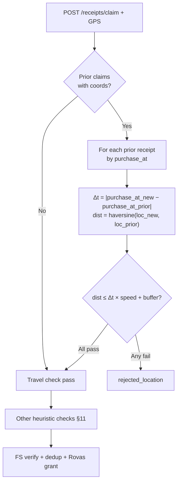

# Civic — Pre-Implementation Plan

**Status:** Approved — Phase 1 implementation in progress. Wage basis: **net** (see `packages/shared/src/settings.ts`).

**Project root:** `/Users/sano/Documents/homeProjects/civic`

**Validated assumption:** Scanning a real eKasa receipt QR and calling the FS registry API returns VAT amounts matching the printed slip. A successful API response confirms the receipt is registered with Finančná správa (see §4).

---

## 1. Product goal

Build **Civic**, a Slovak-first mobile app that lets users see and grow their **contribution to society**, expressed in Merits (ME) on their Rovas account. Three Merit-earning paths are surfaced from day one:

1. **Tax payment** — VAT verified via eKasa receipt scan (v1); income tax later
2. **Charitable contribution** — donate to or invest in a Rovas-listed project
3. **Volunteer work** — report hours against a Rovas project

Merits represent labor-hour equivalents (Rovas convention: **10 ME = 1 hour**). Every path converts an act of economic value-surrender into the same Merit unit so a single dashboard can show the user's contribution mix.

**v1 implementation strategy:** the **VAT-receipt path is built end-to-end**. The other two paths (charity, volunteer) plus the investment side-path ship as **navigational stubs that hyperlink to existing Rovas project pages** — so the full information architecture is visible to users while the heavier Rovas-side endpoints (charity list, volunteer-report proxy, ME aggregates) are designed in later phases. See §9 for the screen-by-screen v1 status and §15 for the phase plan.

**Out of scope for v1:**

- Bank account parsing / open banking
- Income tax or payroll withholding
- OCR-only receipts without eKasa QR / UID
- Official Finančná správa endorsement
- Tax refunds or legal tax advice
- Native in-app charity donation flow (v1 hyperlinks to Rovas)
- Native in-app volunteer-report submission (v1 hyperlinks to Rovas)
- Cross-path **Merit acquisition history** (full ledger of where/when/how much ME was earned — see §16)

**Future (not planned here):** donation receipts, eFaktúra B2B (2027+), bank estimates as non-Merit dashboard, in-app investment flow with auto-Merit yield.

---

## 2. System architecture



**Trust boundary:** Users sign in via **Rovas OAuth** (no separate app-specific account). The Expo app stores only a Rovas **access token** (secure storage). Civic API validates that token with Rovas on every request; it never stores per-user API-KEY/TOKEN pairs.

---

## 3. Repository strategy

### Decision (confirmed)

| Piece | Where |
|-------|-------|
| Expo mobile app | **`civic`** monorepo — Cursor project at `~/Documents/homeProjects/civic` |
| Civic API | Same repo (`services/api`) |
| Shared types + Merit math | Same repo (`packages/shared`) |
| Rovas OAuth2 server | **`oauth2_server` contrib** + thin **`rovas_oauth`** custom wrapper |
| Rovas Merit grant rule | Existing **`rovas`** repo only |

**Do not** embed Expo under the Drupal tree. Rovas partner integrations are documented in the sibling repo at `../rovas/sites/all/modules/custom/rovas_api_endpoints/THIRD_PARTY_ACCOUNT_CREATION.md`.

### Monorepo layout

```
~/Documents/homeProjects/civic/          ← this project (Cursor workspace)
├── apps/mobile/          Expo (Expo Router)
│   └── locales/{sk,en}.json    ← Slovak primary (sk), English secondary (en)
├── services/api/         Node + TypeScript (Fastify or Hono)
├── packages/shared/      Types, Merit conversion, QR/UID parsing
├── docs/
│   ├── plan.md           ← this document
│   ├── architecture.md
│   ├── ekasa-receipt-api.md    ← FS lookup contract (spike findings)
│   └── rovas-integration.md
├── identity/             Brand assets (ME_logo.svg, etc.)
├── mocs/                 Mockups (civic-mock.ai, civic-mockup.canvas.tsx)
├── .env.example
├── pnpm-workspace.yaml
└── README.md

~/Documents/homeProjects/rovas/         ← sibling repo; Rovas-side changes only
├── sites/all/modules/contrib/oauth2_server/   ← NEW contrib dependency
├── sites/all/modules/custom/rovas_oauth/    ← thin wrapper (HybridAuth UI, Services Bearer)
├── sites/all/modules/custom/rovas_site_rules/rules/rules_proxy_claim_vat_receipt.json
└── docs/integration/civic.md
```

Optional: multi-root Cursor workspace file linking `civic` and `rovas` when editing Rules + API together.

### Language strategy

| Surface | Primary | Secondary |
|---------|---------|-----------|
| User-facing UI (Expo screens, push, app store listing) | **Slovak (`sk`)** — first target audience | English (`en`) — fallback for non-SK users |
| Code, identifiers, comments, commits, error messages, logs | **English** | — |
| Docs (this plan, ADRs, API specs) | **English** | — |
| User-facing Slack/email support copy | Slovak | English |

i18n implementation: a flat key/value JSON per locale at `apps/mobile/locales/{sk,en}.json` with `en` as the fallback chain. UI strings live behind keys (no hard-coded SK literals in components), so adding more locales later is mechanical. Currency, date, and number formatting use `Intl` with locale `sk-SK` by default.

---

## 4. eKasa verification (QR → FS registry lookup)

Third-party expense apps and the official Over doklad / ePeňaženka apps do **not** read VAT from the QR matrix. They extract the receipt **UID** from the QR, then fetch receipt details from Finančná správa servers. Civic follows the same pattern.

### Consumer surfaces (reference)

| Surface | Status | Notes |
|---------|--------|-------|
| **FS MDU API** | **Works** | Undocumented; powers OPD portal — see below |
| [opd.financnasprava.sk](https://opd.financnasprava.sk/#!/check) | Web UI confusing | Report form UX; underlying API accepts UID-only lookup |
| [overenie.financnasprava.sk](https://overenie.financnasprava.sk/) | **Dead** | Page not found |
| Over doklad / ePeňaženka (official apps) | Works | Same registry backend |
| Merchant eKasa APIs (PortOS/NineDigit) | N/A | Cash-register operators only |

Full API notes: **`docs/ekasa-receipt-api.md`**.

### QR → UID

QR content is the UID string (`O-[A-F0-9]{32}`, case-insensitive) or a URL containing it. Shared parser in `packages/shared`. Manual UID entry fallback on scan failure.

### Registry lookup (verification + VAT)

**Endpoint** (reverse-engineered from OPD portal):

```
POST https://ekasa.financnasprava.sk/mdu/api/v1/opd/receipt/find
Content-Type: application/json
Origin: https://opd.financnasprava.sk
Referer: https://opd.financnasprava.sk/
```

**Request** (online receipt — v1 primary path):

```json
{ "receiptId": "O-7AF0CFF74D45483FB0CFF74D45283FA1" }
```

**Success:** `returnValue === 0` and non-null `receipt` object.

**Verification rule:** a positive response means the receipt **exists in the e-Kasa registry** — the transaction was registered with Finančná správa. Civic treats this as **verified** (same trust level as Over doklad). Only verified receipts proceed to Merit preview and claim.

**VAT for Merits:** derive `vat_eur` from the response — prefer `vatAmountBasic + vatAmountReduced`, or sum `vatSummary[].vatAmount`. Also available: `totalPrice`, `items[]`, `organization.name`, `createDate`, `customerId` (often null).

**Failure:** non-zero `returnValue`, null `receipt`, HTTP/WAF errors, or unknown UID → show error; **no claim**.

### v1 flow



| Case | Identifier | v1 support |
|------|------------|------------|
| Online receipt | `O-` + 32 hex chars | Yes — UID → `receipt/find` |
| Offline receipt | OKP + cash register metadata | Defer to v1.1 (alternate request body) |
| Non-eKasa / invalid QR | — | Show clear error |

### Spike task (before Phase 1 coding)

1. Confirm lookup on 3–5 real receipt UIDs; document in `docs/ekasa-receipt-api.md`.
2. Map `notification` values when `receipt` is null (offline pending, not found, etc.).
3. Confirm VAT recap handling when summary rows are incomplete (FS notice re Jan 2025 DPH rates).
4. Test WAF behaviour from Civic API server IP; document required headers.
5. Record merchant address fields in FS JSON (`organization` name, street, city) for merchant-proximity geocoding (§11).

### Caveats

- **Undocumented API** — no official developer program; may change or rate-limit without notice.
- **Not buyer-bound** — registry confirms the sale happened, not who paid (§11).
- **Header sensitivity** — bare requests may be WAF-blocked; send `Origin` / `Referer` as OPD portal does.

**Gate:** Phase 1 starts after spike confirms `receipt/find` works for real UIDs and VAT totals are usable.

---

## 5. Merit conversion

Align with Rovas (`hours = merits / 10`):

```
merits = round((vat_eur / hourly_wage_eur) * 10, 2)
```

| Parameter | Source | Notes |
|-----------|--------|-------|
| `vat_eur` | FS `receipt/find` response (`vatAmountBasic + vatAmountReduced` or `vatSummary`) | Registry-verified |
| `hourly_wage_eur` | Config / env | e.g. ŠÚ average gross monthly ÷ 160; document chosen basis |
| `merits_per_hour` | Fixed `10` | Matches Rovas default |

Store `hourly_wage_eur` and `formula_version` on each claim for auditability when the rate changes annually.

**Decision (2026-08):** use **net** hourly wage. Default and overrides live in `packages/shared/src/settings.ts` / `HOURLY_WAGE_EUR` env. Document the basis in the app FAQ at launch.

### Display rounding (UI rule)

Storage and the `merits` API field keep two decimal places (`round(..., 2)`) for auditability. The mobile UI **always rounds Merit totals and EUR equivalents to whole numbers** when displaying them on screen (home dashboard, profile, community lookup, receipt history ME column, investment yields, etc.). Show units explicitly (`ME`, `€`) rather than implied; per-receipt VAT amounts in EUR keep their original precision because they are actual payments, not equivalents. Investment yields are presented per-year (whole-number ME) rather than fractional per-month.

### Splitting across multiple recipients

When a single receipt is claimed for multiple Rovas users (§7), the **total** is derived from the FS receipt exactly as above; per-share Merits are `floor(total * share_pct / 100, 2)` and any rounding residue is assigned to the scanner so the sum of per-share Merits equals the receipt total exactly. The receipt's `merits` API field always reports that total; per-share amounts live in the `shares[]` response array.

---

## 6. Civic API design

**Stack:** Node 20+, TypeScript, Fastify (or Hono), SQLite for MVP (Postgres for production), Zod for validation.

### Endpoints (v1)

| Method | Path | Auth | Purpose |
|--------|------|------|---------|
| POST | `/receipts/verify` | Rovas Bearer optional | Extract UID, call FS `receipt/find`; return verified preview (no grant). Optional `location` in body — stored ephemerally (session/cache) for verify→claim drift check (§11) |
| POST | `/receipts/claim` | Rovas Bearer required | Verify, dedup, location + heuristic fraud checks (§11), grant Merits via Rovas, persist claim. Body: `qr_or_uid`, optional `shares[]`, required `location: { lat, lng, accuracy_m? }` from device GPS at claim time — see §7 |
| GET | `/users/search` | Rovas Bearer required | Typeahead for split-claim recipients (§7). `?q=<≥3 chars>`; returns up to 10 `{ rovas_uid, username, display_name }` rows. Proxies the new Rovas search endpoint (§8c). Separate from `/users/lookup` |
| GET | `/users/me/summary` | Rovas Bearer required | Total VAT claimed, total ME, receipt count, Rovas profile hint |
| GET | `/receipts` | Rovas Bearer required | Paginated claim history for authenticated `rovas_uid` — returns shares the caller received plus, in a secondary view, receipts they submitted (§7) |
| GET | `/me/contributions/summary` | Rovas Bearer required | Per-category ME breakdown for screen 0 (taxes, charity, volunteer); v1 reads taxes only — charity/volunteer counts are 0 until those paths ship |
| GET | `/community/contributions/summary` | Public | Aggregate ME totals + per-category breakdown for the logged-out screen 0 |
| GET | `/charities/projects` | Public | Proxies the new Rovas charity-projects endpoint (§8c); query param `?type=charity\|invest` differentiates screens 3 and 5; each item carries a canonical `rovas_url` for v1 hyperlink-out |
| GET | `/rank/distribution` | Public (Rovas Bearer optional) | Proxies the existing **Rovas Merit Distribution** module Services endpoint; returns log-scale buckets `[{ label, count }]` for the histogram on screen 0. With a Bearer token, the response also returns `user_bucket_index` so the mobile app can highlight the caller's bucket and label it with their Rovas username |
| GET | `/users/lookup` | Rovas Bearer required | **Phase 3+ stub** — `?username=<rovas_username>` returns a minimal public profile (`rovas_uid`, `display_name`, totals, percentile) for the Komunita screen. v1 returns 501 Not Implemented |

No local auth endpoints — login happens entirely via Rovas OAuth in the Expo app.

Endpoints marked **stub** in §9 are backed by `/charities/projects`, `/community/contributions/summary`, `/rank/distribution`, and `/users/lookup`. They never write — they only read and forward to Rovas.

### Claim flow (server-side)



### Data model (MVP)

**receipt_claims** (one row per receipt) — id, receipt_uid (UNIQUE globally), submitted_by_rovas_uid, vat_eur, total_merits_awarded, merchant_name, purchase_at, hourly_wage_eur, formula_version, buyer_identifier (nullable), payment_method (nullable), fs_verified_at, claim_lat (nullable), claim_lng (nullable), claim_location_accuracy_m (nullable), created_at

**receipt_claim_shares** (one row per beneficiary, ≥ 1 per claim — see §7) — id, claim_id (FK → receipt_claims), beneficiary_rovas_uid, share_pct, merits_awarded, rounding_residue, created_at. UNIQUE (claim_id, beneficiary_rovas_uid). Solo claims still create exactly one share row at 100%.

**claim_attempts** — id, receipt_uid, submitted_by_rovas_uid, outcome (`claimed` | `duplicate` | `rejected_window` | `rejected_rate` | `rejected_shares` | `rejected_location` | `rejected_merchant_distance` | `rejected_future_receipt` | `rejected_scan_lag` | `error`), claim_lat (nullable), claim_lng (nullable), created_at — used for strike counting and audit. Strikes always attach to the scanner, not to recipients.

**user_strikes** — rovas_uid, strike_count, blocked_until (nullable), updated_at — optional; can derive from claim_attempts if preferred.

Global UNIQUE on `receipt_uid` prevents double-claim across users. Indexes on `submitted_by_rovas_uid` (scanner history) and `receipt_claim_shares.beneficiary_rovas_uid` (per-user "my Merit credits" history).

No local `users` or `rovas_links` tables — identity comes from the OAuth token. The per-device recipient memory for split claims lives only on the client (§7).

---

## 7. Receipt sharing (split claims)

**Motivation.** Many real purchases are paid from a shared household budget — one person scans the receipt, but the VAT effectively came from multiple Rovas users (typically a family). v1 makes this explicit: at claim time the scanner can split a receipt's Merits across several Rovas users, instead of forcing a "first to scan keeps everything" race or after-the-fact corrections.

### User flow (screen 2, between verify and claim)



Defaults and constraints:

- A fresh scan starts at **100% to the scanner**, plus any **vždy zdieľať** (always share) recipients pre-populated from local memory; the initial split is recalculated to be **equal across all included recipients**.
- Adding or removing a recipient triggers automatic equal-share recalculation across the new set; users can then override any row. The UI rebalances remaining rows so percentages always sum to 100 within rounding tolerance (server still validates).
- Each row shows: avatar, Rovas display name + `@username`, share %, remove icon, and — for memorised rows — a **vždy zdieľať** toggle.
- **The scanner is always included** as one of the recipients in v1 (cannot drop themselves to 0). Pure delegation/transfer of a receipt to other users is out of scope.
- A claim must have **at least one recipient** (always the scanner in solo mode) and **no duplicate recipients**.

### Recipient discovery

| Source | Behaviour |
|--------|-----------|
| **Search** | Autocomplete against `/users/search?q=<prefix>` (≥ 3 chars). Returns up to 10 `{ rovas_uid, username, display_name }` matches. Backed by new Rovas endpoint (§8c). |
| **Memory (local)** | Recently-selected recipients persisted on-device (e.g. `AsyncStorage`; OAuth tokens still use `expo-secure-store`). Sorted by last-used, capped at ~20 entries; LRU eviction. |
| **Always-share** | Subset of memory the user has flagged. Auto-included on every new scan (and visible/removable in that scan's split list). Toggling off removes the auto-include but keeps the user in memory. |

Memory is purely client-side in v1 — there is no server-side address book. The server only ever sees the final `shares` array for the claim being submitted. Uninstalling the app erases the memory.

### Split rounding (UI + server)

- UI surfaces whole-percent values to the user, but `share_pct` is stored and transmitted with up to 2 decimal places.
- Per-share Merit amount: `floor(total_merits * share_pct / 100, 2)`; any **rounding residue is assigned to the scanner** so the sum of per-share Merits equals the receipt total exactly. The residue is recorded on the scanner's share row (`rounding_residue`) for auditability.
- Server validates `sum(share_pct) == 100 ± 0.01`; otherwise rejects with `rejected_shares` (no Rovas call made).

### API changes (Civic API, §6)

| Method | Path | Change |
|--------|------|--------|
| POST | `/receipts/claim` | Body now accepts `shares?: [{ rovas_uid, share_pct }]`. Omitted → defaults to `[{ rovas_uid: caller, share_pct: 100 }]`. Validation: ≥ 1 share, scanner included, distinct `rovas_uid`s, sum ≈ 100. Response now contains `total_merits` plus a `shares[]` array with per-beneficiary `merits_awarded`. |
| GET | `/users/search` | **New.** Bearer required. `?q=<≥3 chars>` returns up to 10 `{ rovas_uid, username, display_name }` rows. Lightweight typeahead — distinct from the heavier `/users/lookup` (Phase 3+ public-profile endpoint for screen 6). |

### Data model addition (§6)

Receipt persistence becomes parent + children:

- **receipt_claims** — one row per receipt, keyed by `receipt_uid`, owned by `submitted_by_rovas_uid`, with `total_merits_awarded`.
- **receipt_claim_shares** — one row per beneficiary, FK to claim, with `share_pct`, `merits_awarded`, `rounding_residue`. UNIQUE on `(claim_id, beneficiary_rovas_uid)`. Solo claims still create exactly one share row at 100%.

History queries:

- "Moje merity z bločkov" (Merits I received) = `receipt_claim_shares` joined to `receipt_claims` where `beneficiary_rovas_uid = caller` — shows per-share Merit credit plus the originating receipt and the scanner.
- "Moje naskenované bločky" (receipts I submitted) = `receipt_claims.submitted_by_rovas_uid = caller` — secondary tab on screen 2.

### Server-side claim flow (amended)



Atomicity is mandatory: either every share gets credited on Rovas and recorded in `receipt_claim_shares`, or nothing does. The Rovas rule must run all `rules_give_merits_to_user` calls inside a single Drupal transaction (§8b).

### Privacy and consent

- v1 treats included recipients as **implicitly consenting** — the canonical use case is family members sharing a household budget, where explicit per-receipt confirmation would be friction without value. Recipients see the Merit credit in their Rovas account and can flag abuse out-of-band.
- The scanner only sees public Rovas fields (`username`, `display_name`) via `/users/search` — no email, no balance, no contributions.
- Recipient memory lives only on the scanner's device; uninstalling the app erases it.
- **Phase 3+:** Rovas-side opt-out preference ("Don't include me in others' split claims"); when set, the user is filtered from `/users/search` results and any submitted claim including them is rejected (`rejected_shares`).

### Fraud impact (cross-reference §11)

- Strikes always attach to the **scanner** (`submitted_by_rovas_uid`), never to passive recipients.
- Per-recipient monthly Merit cap (Tier 2) applies to the credited beneficiary, not the scanner — so a scanner cannot dump unlimited Merits onto one recipient.
- Per-(scanner → recipient) monthly Merit cap (Tier 2) limits how much one user can route to another, deterring Merit-laundering rings. Default is high enough not to interfere with normal family use.
- Failed share validation increments `claim_attempts` with outcome `rejected_shares`.
- Location and heuristic rejections (`rejected_location`, `rejected_merchant_distance`, etc.) attach to the scanner; see §11.

### Rovas changes summary (cross-reference §8)

- `rules_proxy_claim_vat_receipt` accepts a `shares` array; loops `rules_give_merits_to_user` atomically per beneficiary; solo claims are just a one-entry array (§8b).
- New `GET /rovas/users/search?q=` Services endpoint returns minimal public-profile rows for typeahead — separate from the heavier `/users/lookup` planned for Phase 3+ (§8c).

### Phasing

- **Phase 1** — not present (no claim flow yet; verify-preview only).
- **Phase 2** — ships split claims end-to-end together with the basic claim flow, so v1 production never has a "solo-only" claim phase. Includes Rovas `/users/search`, the multi-beneficiary rule, the `receipt_claim_shares` table, and the mobile split UI on screen 2.
- **Phase 3** — opt-out preference, server-side address book if user research justifies one, possible recipient-side notifications.

---

## 8. Rovas integration (rovas repo)

Rovas changes fall into two tracks: **OAuth server** (new, for login) and **Merit grant API** (new rule).

### 8a. Rovas OAuth2 server (oauth2_server contrib)

Rovas today uses HybridAuth only as an **OAuth client** (login via Google, Facebook, Nabezky, etc.). There is **no OAuth server** in the repo yet.

**Decision:** Use the Drupal 7 contrib module **[oauth2_server](https://www.drupal.org/project/oauth2_server)** as the authorization server foundation.

Add a thin custom module **`rovas_oauth`** (depends on `oauth2_server`) for Rovas-specific glue only:

| Responsibility | Module |
|----------------|--------|
| OAuth2 server core, clients, scopes, token storage | **oauth2_server** (contrib) |
| Login UI on authorize page (HybridAuth + Drupal login) | **rovas_oauth** |
| Map Bearer token → `rovas_uid` for Services rules | **rovas_oauth** |
| Export **civic** OAuth client config for dev/prod | **rovas_oauth** (Features or documented manual setup) |

**OAuth client:** Register the **civic** mobile app in oauth2_server admin with:

- Grant type: **Authorization Code** (+ **PKCE** — see caveat below)
- Redirect URIs: `civic://oauth/callback` (production), Expo dev redirect for development
- Scopes: start with module defaults; add custom scope e.g. `merits:claim` if needed
- Public client (no client secret) for mobile

**PKCE caveat (Phase 0 spike):** Tracked in [drupal.org#3015065](https://www.drupal.org/project/oauth2_server/issues/3015065). Spike must confirm PKCE on dev; extend **`rovas_oauth`** if the contrib patch is insufficient.

**Partner API (`rovas_partner_user`)** remains for other integrations, not Civic login.

### 8b. Merit grant and read APIs

| Endpoint | Role |
|----------|------|
| `POST /rovas/rules/rules_user_s_merits` | Read Merit balance (Bearer or API-KEY auth) |
| `rules_give_merits_to_user` | Called inside new claim rule (internal) |

Dev target: **`https://dev.rovas.app`**

### New: `rules_proxy_claim_vat_receipt`

**Logic (summary):**

1. Resolve caller (the scanner) via **OAuth Bearer** (preferred) or legacy API-KEY/TOKEN
2. Reject if `receipt_uid` already in `{civic_claims}` table on Rovas — belt-and-suspenders with API dedup
3. Validate the incoming `shares` array (§7): non-empty, distinct `beneficiary_rovas_uid` values, percentages sum to 100 (± rounding tolerance), each beneficiary resolves to a real Rovas user, scanner is included
4. Compute total merits, then per-share Merit amounts (`floor(total * share_pct / 100, 2)`, scanner absorbs rounding residue)
5. Inside a single Drupal transaction, invoke `rules_give_merits_to_user` once per beneficiary — **atomic**: any failure rolls the whole claim back so partial Merit credit is impossible
6. Persist the claim + per-beneficiary rows in `{civic_claims}` / `{civic_claim_shares}`
7. Return `{ total_merits_awarded, shares: [{ beneficiary_rovas_uid, merits_awarded }], result, result_explain }`

A solo claim is just a shares array of one entry at 100%, so this same code path covers both flows.

**Expose via Services:** `POST /rovas/rules/rules_proxy_claim_vat_receipt`

**Pointer doc in rovas:** `docs/integration/civic.md`

### Rovas spikes (Phase 0)

- Install **oauth2_server** on dev.rovas.app
- Verify **PKCE** end-to-end (patch #3015065 if needed)
- Register **civic** OAuth client; confirm Authorization Code + PKCE with Expo or curl
- Prototype **rovas_oauth** authorize page with Google + Facebook HybridAuth
- Confirm Bearer token resolves to `rovas_uid` for Services rules

### 8c. Rovas read endpoints used by Civic

Civic's home, earn-hub, and community screens consume read-only signals from Rovas. Some are existing module endpoints we just need to expose / expose-via-Services; others are new and gated behind later phases.

| Endpoint (working name) | Used by (Civic screen) | Returns | Status |
|-------------------------|------------------------|---------|--------|
| `GET /rovas/merit_distribution` | Screen 0 (rank histogram) | Log-scale buckets `[{ label, count }]` for global Merit balance distribution; with auth, includes `user_bucket_index` so the highlighted bar and username label can be drawn | **Existing** — produced by the **Rovas Merit Distribution** module already in production. v1 just needs Services-Bearer auth confirmed and Civic API proxying. |
| `GET /rovas/projects?type=charity` | Screen 3 (Charitatívne projekty) | Project list with `id, title, organization, summary, rovas_url, currency_amount_collected` | Phase 2 stretch |
| Rovas page `/charity-projects` | Screen 3 (invite form) | Public instructions for charities on how to create a Rovas project; linked from the preset invite e-mail and the intro copy above the invitation form | **Rovas TODO** — page does not exist yet; create on `rovas.app` before the invite flow ships |
| `GET /rovas/projects?type=invest` | Screen 5 (Investičné projekty) | Same shape; `expected_yield_me_per_month` extension | Phase 2 stretch |
| `GET /rovas/contributions/aggregate` | Screen 0 logged-out + per-user position calc | `{ total_me, by_category: { taxes, charity, volunteer } }`, plus optional `user_percentile` when called with Bearer | Phase 2 stretch |
| `GET /rovas/users/search?q=…` | Screen 2 (split-claim recipient picker, §7) | Minimal `[{ rovas_uid, username, display_name }]` for typeahead. `q` ≥ 3 chars, ≤ 10 results, public fields only. Honours per-user "not searchable" preference (Phase 3+). | **Phase 2** — ships with the multi-beneficiary claim rule. Separate from `/users/lookup`. |
| `GET /rovas/users/lookup?username=…` | Screen 6 (Komunita) | Public-profile shape for a Rovas user: `rovas_uid, display_name, total_me, by_category, percentile, public_projects[]`. Honours each Rovas user's privacy preferences. | **Phase 3+** — implemented later, after the broader v1 ships. |
| `POST /rovas/rules/rules_proxy_volunteer_report` | Screen 4 (Dobrovoľnícka práca) | Submits a simplified volunteer report (project, date, hours, description) and returns Merit grant outcome | Phase 3 |

**v1 behaviour:**

- **Screen 0 (rank histogram)** — calls the existing Merit Distribution endpoint via Civic API on day one. This is the only stub-related Rovas endpoint that already exists; no Phase-2 swap needed.
- Screens 3 and 5 render a **statically curated** list (in Civic API config) of 4–6 hand-picked Rovas project URLs and just hyperlink out.
- Screen 3 also ships an **invite-organisation** e-mail form (mockup: collapsible card below the list). The preset body and intro copy link to **`https://rovas.app/charity-projects`** — that Rovas landing page must be created (see §8c table row).
- Screen 0 logged-out shows a placeholder community total (or hides the aggregate block) until the aggregate endpoint lands.
- Screen 4 disables submit and shows a "coming soon" notice with a link to the existing Rovas form.
- **Screen 6 (Komunita)** — disabled search input + skeleton recent-profiles table. Civic API returns `501` for `/users/lookup`. Promoted in Phase 3+ once the Rovas username-lookup endpoint exists.

Promotion path: when each Rovas endpoint ships, swap the corresponding Civic API stub from a static-config response to a live proxy. No Civic mobile changes beyond removing the "stub" badge and enabling disabled controls.

---

## 9. Expo mobile app

### Stack

- **Expo SDK 52+** with Expo Router
- **TypeScript**
- **expo-camera** (barcode scanning)
- **expo-location** — foreground GPS at claim time (required permission; §11 travel-consistency checks)
- **expo-secure-store** for Rovas OAuth tokens
- **expo-auth-session** — Authorization Code + PKCE
- **i18n:** Slovak primary, English secondary

### Screens (v1)

Slovak labels are the user-facing source of truth (see §3 Language strategy). Routes use English identifiers. The interactive mockup of every screen lives at [`mocs/civic-mockup.canvas.tsx`](../mocs/civic-mockup.canvas.tsx); the Cursor IDE picks it up via a symlink in `~/.cursor/projects/.../canvases/`, so edits in either path stay in sync.

| # | Route | Slovak label (UI) | English (dev) | v1 status |
|---|-------|-------------------|---------------|-----------|
| 0 | `/(tabs)/index` | Váš príspevok spoločnosti | Home / contribution dashboard | **Fully built** — logged-in: user ME total (rounded, whole-number) + EUR equivalent + **rank histogram** (sourced from existing Rovas Merit Distribution module, §8c) with the user's bucket highlighted and username labelled + community-position callout (the word "komunite" deep-links to screen 6). Logged-out: aggregate community total + same rank histogram without highlight + sign-in/register CTAs. |
| 1 | `/(tabs)/earn` | Získať merity | Earn hub | **Fully built** — three numbered cards routing to children |
| 2 | `/(tabs)/earn/receipts` | Bločky | Receipts | **Fully built** — eKasa scan + claim history (the §4 / §6 receipt flow lives here). After verify and before claim, the user can **split the Merits across multiple Rovas users** (§7): the scanner is pre-seeded at 100% plus any "vždy zdieľať" recipients from local memory; recipients are added via a Rovas-user search dialog or picked from a previously-shared list; shares default to equal split with per-row override. History tabs show both "Moje merity z bločkov" (shares the user received) and "Moje naskenované bločky" (receipts the user submitted). |
| 3 | `/(tabs)/earn/charity` | Charitatívne projekty | Charity projects | **Stub** — list backed by `/charities/projects?type=charity`; each item hyperlinks to `rovas.app/project/<id>`; invite form below the list links to `rovas.app/charity-projects` (Rovas page **TODO**) |
| 4 | `/(tabs)/earn/volunteer` | Dobrovoľnícka práca | Volunteer report | **Stub** — form skeleton mirroring the simplified Rovas form; submit disabled with "coming soon" until §8c proxy ships |
| 5 | `/(tabs)/earn/invest` | Investičné projekty | Investment projects | **Stub** — list backed by `/charities/projects?type=invest`; each item hyperlinks to `rovas.app/project/<id>` |
| 6 | `/(tabs)/community` | Komunita | Community / user lookup by Rovas username | **Stub** — disabled search input + skeleton recents table; promoted in Phase 3+ once `/users/lookup` (§8c) ships |
| — | `/(auth)/login` | Prihlásenie | Login | **Fully built** — Rovas OAuth (Google / Facebook / Rovas) |
| — | `/(auth)/register` | Registrácia | Registration | **Fully built** — same OAuth providers, framed for first-time users; HybridAuth auto-creates the Rovas account |
| — | `/(tabs)/profile` | Profil | Profile | **Fully built** — Rovas user info, Merit balance, sign out. **Post-v1:** entry point to a Merit acquisition history screen (§16) — parity with the Rovas user-profile Merit ledger |

The earn-hub child routes (`/earn/receipts`, `/earn/charity`, `/earn/volunteer`, `/earn/invest`) are reached from screen 1's primary CTAs and from the inter-screen links shown in the canvas mockup. Screen 0 surfaces a single primary CTA — "Získať merity" — that routes to screen 1, and inline links such as "komunite" inside the **Vaša pozícia v komunite** callout deep-link to screen 6.

**Navigation TODO:** v1 reaches every screen via inline CTAs and Rovas hyperlinks. As the IA grows past ~6 screens we expect to introduce a **proper navigation menu** — most likely a bottom-tab bar (Domov / Získať / Bločky / Komunita / Profil) with the earn-hub children promoted to a stack inside the "Získať" tab. Track this when the screen count or session-length data justifies it; not part of v1 scope.

### App identifiers

- OAuth redirect scheme: **`civic://oauth/callback`**
- Expo `slug` / package name: **`civic`** (finalize in `app.json` at scaffold time)

---

## 10. Authentication model

**No separate app account.** User identity is the **Rovas user** established through OAuth.



---

## 11. Receipt fraud mitigation

**Threat:** Anyone can pick up a discarded receipt, scan the QR, and claim Merits they did not earn. eKasa receipts are **not inherently buyer-bound** — registry verification proves a sale happened, not who paid.

### What FS verification exposes

| Field | Source | Useful for buyer binding? |
|-------|--------|---------------------------|
| Receipt UID (`O-…`) | QR + FS response | Dedup only |
| VAT total | FS `receipt/find` | Registry-verified |
| Date/time, merchant | FS response | Heuristics only |
| Merchant address / org metadata | FS `organization` when present | Geofence heuristics (§11) |
| Payment method | FS `receipt.payments` when present | **No** — not linked to a person |
| **customerId** | FS response when buyer ID provided at sale | **Yes when present**, rare in retail |

Phase 0 spike must record which payment/buyer fields appear in FS JSON, and whether merchant street/city/coordinates are present or geocodable.

### Tier 1 — v1 mandatory

- **Global UID dedup** — first claim wins; others get `409`
- **claim_attempts** log for every duplicate try
- **3-strike policy:** 3 duplicate attempts in 30 days → temporary claim block (no Merit deduction in v1)

### Tier 2 — v1 recommended

- **30-day claim window** from receipt timestamp
- Rate limits (e.g. 20/day, 200/month) — counted **per scanner** (`submitted_by_rovas_uid`)
- Minimum Rovas account age (24h)
- Monthly Merit cap — enforced **per recipient** so a scanner cannot dump unlimited Merits onto another user via split claims (§7)
- Per-(scanner → recipient) monthly Merit cap — extra guard against using split claims as a Merit-laundering channel; default high enough not to interfere with normal family use
- **Location-based travel consistency** — see below
- **Additional low-hanging heuristic checks** — see below

### Location-based travel consistency (v1 — simple heuristics)

**Goal:** Reject claims when the scanner's device location at claim time is **inconsistent with physically reaching prior claimed receipts** using normal ground transport in the elapsed time between receipt timestamps. This targets trashcan-receipt farming (someone collecting slips far from where they actually shop) and bulk forwarding of receipt photos.

**Data captured at claim time (required in v1):**

- Expo requests foreground location permission before the first claim; `POST /receipts/claim` includes `location: { lat, lng, accuracy_m? }`.
- Persist `claim_lat`, `claim_lng`, `claim_location_accuracy_m` on `receipt_claims` and on every `claim_attempts` row (including rejections).
- Use FS `purchase_at` (receipt issue time) as the temporal anchor — not scan/claim wall-clock time — so a user can scan an old slip later without false positives, as long as their *chain* of receipts remains geographically plausible.

**v1 algorithm (per scanner, on each new claim):**

1. Load the scanner's **prior successful claims** ordered by `purchase_at` (most recent first; cap lookback e.g. 90 days or last 50 claims for performance).
2. For each prior claim with stored coordinates, compute:
   - `Δt_hours` = absolute difference between the two receipts' `purchase_at` values (minimum 15 minutes floor to avoid divide-by-zero noise on same-minute purchases).
   - `distance_km` = haversine distance between `(claim_lat, claim_lng)` pairs.
   - `max_plausible_km` = `Δt_hours × MAX_GROUND_SPEED_KMH` + `LOCATION_BUFFER_KM`.
3. If **any** pairwise check fails (`distance_km > max_plausible_km`), reject with outcome `rejected_location` and a user-facing message (SK): location inconsistent with prior receipts — no Rovas grant.
4. **First claim** for a user skips the travel check (no prior anchor). **Missing/unusable GPS** (permission denied, accuracy worse than e.g. 500 m, or `(0,0)`) → reject claim in v1 rather than silently skipping — location is part of the trust model.

**v1 defaults (env-configurable, tune after beta):**

| Parameter | Default | Rationale |
|-----------|---------|-----------|
| `MAX_GROUND_SPEED_KMH` | `100` | Generous ceiling for car/bus on SK highways; intentionally excludes air travel as "normal" |
| `LOCATION_BUFFER_KM` | `25` | Absorbs GPS error, parking vs shop offset, dense urban cores |
| `MIN_DELTA_T_HOURS` | `0.25` | Same-hour shopping trips at nearby malls |
| Travel lookback | 90 days / 50 claims | Bounded query cost |

**What v1 explicitly does *not* do:** reverse-geocode merchants, detect mock-location apps, or require the user to be near the merchant at scan time (that's a separate low-hanging check below). v1.1 can tighten speed caps for cross-border receipts, add merchant geofencing, and flag statistically impossible claim chains.



### Additional low-hanging fruit checks (v1 recommended)

Cheap server-side rules that complement location and dedup. Implement in Phase 2 alongside travel consistency; all log to `claim_attempts` with distinct outcomes.

| Check | Rule (v1 default) | Outcome | Rationale |
|-------|-------------------|---------|-----------|
| **Merchant proximity at claim** | If FS returns merchant street/city (or Phase 0 geocode cache hit), reject when claim GPS is **> 50 km** from merchant | `rejected_merchant_distance` | Catches scanning a Bratislava slip from Košice — classic trashcan fraud |
| **Future receipt timestamp** | Reject when `purchase_at > now + 5 min` clock skew | `rejected_future_receipt` | Trivial sanity check |
| **Stale scan lag** | Reject when `now − purchase_at > 30 days` (same as claim window) | `rejected_window` | Already in Tier 2; enforce on both receipt time and scan time |
| **Impossible same-day burst** | > 10 successful claims in any rolling 60 minutes **and** pairwise max speed exceeded between consecutive claims by `purchase_at` | `rejected_location` | Stops scripted bulk uploads even when individual pairs might slip through |
| **Duplicate merchant same hour** | Flag (v1: log only; v1.1: soft reject) when same `merchant_name` + same scanner + `purchase_at` within 30 min | audit flag | Legitimate for repeat coffee runs; useful for manual review |
| **Verify → claim location drift** | If `/receipts/verify` also sends location and claim is **> 100 km** away within 30 minutes | `rejected_location` | Detects verify-once, claim-from-elsewhere relay attacks |
| **Minimum receipt VAT** | Reject claims below e.g. **€0.01 VAT** (config) | `rejected_rate` or new `rejected_trivial` | Blocks zero-value noise farming |

**Deferred (not v1):** mock-GPS / root detection, photo-of-receipt proof, device attestation, IP-only geolocation (too coarse), bank/card matching, buyer-ID binding until spike confirms fields.

### Tier 3 — v1.1 if spike confirms buyer ID

- Bind claims to `customerId` when present on FS response
- Tighten merchant geofencing using a cached geocode table built from FS `organization` fields
- Promote duplicate-merchant-same-hour from audit flag to soft reject with override

### Tier 4 — deferred

Bank/card matching, photo proof, e-receipt to verified email, on-device mock-location detection (v2).

### Strike attribution for split claims

Strikes always attach to the **scanner** (`submitted_by_rovas_uid`), never to passive recipients. A user who simply received a share from someone else's bogus claim is not penalised. The Civic API logs every rejected share-validation outcome (`rejected_shares`) and location/heuristic rejections in `claim_attempts` so abuse patterns surface in audit.

### Testing fraud controls

- [ ] User A claims UID → success; user B → 409
- [ ] User B × 3 duplicates → block
- [ ] Receipt older than window → rejected
- [ ] Daily rate exceeded → rejected
- [ ] Split claim with shares summing to 99 or 101 → rejected with clear error (no Rovas calls made)
- [ ] Split claim where one beneficiary fails on Rovas → entire claim rolled back; scanner sees error; no partial Merit credit recorded
- [ ] Claim without GPS permission / bad accuracy → rejected (`rejected_location` or dedicated missing-location code)
- [ ] Two receipts 200 km apart with `purchase_at` 1 hour apart → second claim rejected (`rejected_location`)
- [ ] Same user, receipts 200 km apart with `purchase_at` 3 hours apart → allowed (within 100 km/h + buffer)
- [ ] First-ever claim with valid GPS → allowed (no prior anchor)
- [ ] Claim GPS > 50 km from geocoded merchant → rejected (`rejected_merchant_distance`)
- [ ] Receipt with `purchase_at` in the future → rejected (`rejected_future_receipt`)

---

## 12. Security and privacy

| Risk | Mitigation |
|------|------------|
| OAuth token theft | PKCE, secure-store, short-lived tokens |
| Trashcan receipt fraud | §11 dedup, strikes, window, rate limits, travel-consistency GPS, merchant proximity |
| Fake receipts | FS `receipt/find` must return verified receipt before claim |
| Merit farming | Monthly cap; server-side VAT-only computation from FS response |
| Split-claim Merit dumping | Per-recipient + per-(scanner → recipient) monthly caps (§11); recipients always free to flag abuse |
| Recipient privacy in split-claim search | `/users/search` returns only `username` + `display_name` (no email, no balance); honours per-user "not searchable" preference (Phase 3+); recipient memory is device-local only |
| GDPR | Claims keyed by `rovas_uid`; privacy policy; split-claim recipient memory stays on the scanner's device |

---

## 13. Testing strategy

- [x] FS `receipt/find` returns VAT for sample UID
- [ ] API verify same UID → VAT matches printed receipt
- [ ] Unregistered / fake UID → rejected (no claim)
- [ ] Duplicate claim returns 409
- [ ] Rovas OAuth PKCE on dev.rovas.app
- [ ] Phase 1: scan → preview on device
- [ ] Phase 2: claim increases Merit balance
- [ ] Phase 3: TestFlight / internal APK in real shop lighting

---

## 14. Deployment (high level)

| Component | MVP | Production |
|-----------|-----|------------|
| Civic API | localhost + Expo dev client | VPS subdomain (e.g. `api.civic.example.sk`) |
| Database | SQLite | Postgres |
| Expo | Expo Go | EAS → TestFlight / Play internal |
| Rovas | dev.rovas.app | rovas.app |

---

## 15. Phased delivery

### Phase 0 — Spikes + mockup approval

- FS `receipt/find` contract documented (`docs/ekasa-receipt-api.md`)
- Rovas OAuth + PKCE on dev; register **civic** client
- Hourly wage source chosen
- 6-screen mockup reviewed against the user-supplied Slovak outline (`mocs/civic-mockup.canvas.tsx`)
- Split-claim sub-screens added to the mockup (recipient picker, search dialog, memory list, share editor with auto-rebalance) and signed off (§7)

**Exit gate:** Receipt UID verifies via `receipt/find`; OAuth returns usable Bearer token; mockup signed off including split-claim flow.

### Phase 1 — Navigational shell + verify-preview

- Scaffold **civic** monorepo and locale files (`sk` primary, `en` fallback)
- All 6 screens from §9 ship in the Expo app:
  - Screens 0, 1, 2 are fully built against live data
  - Screens 3, 4, 5 ship as **stubs** with the static curated project list (§8c) and the disabled volunteer form
- API: `/receipts/verify`, `/me/contributions/summary` (taxes-only), `/community/contributions/summary` (placeholder), `/charities/projects` (static config)
- No claim or OAuth yet — preview only

### Phase 2 — Rovas Merits + OAuth + split claims

- OAuth server, claim rule, fraud controls, Expo login + claim
- **Split claims (§7) ship end-to-end in this phase** so v1 never has a "solo-only" production claim flow:
  - Rovas: `rules_proxy_claim_vat_receipt` accepts a `shares` array atomically; new `GET /rovas/users/search` Services endpoint exposed
  - Civic API: `POST /receipts/claim` accepts `shares` + device `location`; `GET /users/search` proxies the Rovas search; `receipt_claim_shares` table added; per-recipient and per-(scanner → recipient) caps enforced; travel-consistency + merchant-proximity heuristics (§11)
  - Mobile: location permission prompt before first claim; GPS attached to verify + claim requests
  - Mobile: screen 2 split UI (search, memory, always-share toggle, default equal split with override, auto-rebalance, sum-to-100 validation); history split into "received Merits" vs "submitted receipts"
- `/me/contributions/summary` reads real Merit history per category, aggregating across received shares
- **Stretch:** if the new Rovas read endpoints from §8c land, swap `/charities/projects` and `/community/contributions/summary` from static config to live proxies
- **Rovas:** create the public `/charity-projects` page linked from screen 3's invite-organisation e-mail template

### Phase 3 — Polish + stores + stub promotion

- SK i18n polish, API deploy, EAS builds
- Promote stubs to first-class flows as Rovas endpoints land (volunteer-report proxy first; in-app charity / invest flows when product is ready)

---

## 16. What we defer

- Bank/card matching, offline OKP receipts, buyer-ID binding until spike confirms fields, mock-GPS detection
- Auto-deduct Merits as fraud punishment, slovensko.sk login, Merit leaderboard in app
- **Merit acquisition history (post-v1)** — a profile-linked screen that lists every Merit credit the user received: source/path (receipt VAT, charity, volunteer, investment yield, split-claim share from another scanner, etc.), timestamp, and amount (whole-number ME in the UI). Rovas already exposes this on the user profile; Civic needs the same transparency so users can see *whether* Merits arrived, *from where*, and *how much*. v1 already covers the receipt-only slice on screen 2 ("Moje merity z bločkov" / "Moje naskenované bločky"); the deferred screen is the **cross-path ledger**, likely backed by a Rovas Merit-history read endpoint proxied through Civic API (`GET /users/me/merit-history` or similar) and reached from Profil. Not required for version 1.

---

## 17. Approval checklist

1. Plan scope approved
2. Hourly wage basis for Merit formula
3. OAuth providers: Google + Facebook + Drupal login
4. FS lookup via undocumented `receipt/find` API — acceptable for v1 (see §4)
5. Fraud defaults: 30d window, daily limits, 3-strike block duration, location travel-consistency (`MAX_GROUND_SPEED_KMH=100`, `LOCATION_BUFFER_KM=25`), merchant proximity 50 km
6. Three-path framing approved — receipts only fully built in v1; charity / volunteer / invest ship as Rovas-hyperlink stubs (§8c, §9)
7. Slovak primary / English secondary i18n strategy approved (§3 Language strategy)
8. 6-screen mockup at `mocs/civic-mockup.canvas.tsx` reviewed and signed off
9. Split-claims approved (§7): scanner is always included; default equal share with override; client-side recipient memory with optional "vždy zdieľať"; atomic multi-beneficiary claim; per-recipient + per-(scanner → recipient) monthly Merit caps

---

## Summary

| Layer | Technology | Location |
|-------|------------|----------|
| Mobile | Expo + expo-auth-session | `civic/apps/mobile` |
| Backend | Node + TS API | `civic/services/api` |
| Shared | Types + Merit math | `civic/packages/shared` |
| Identity | oauth2_server + rovas_oauth | `rovas` repo |
| Ledger | Rovas Rules + Merits | `rovas` repo |

**Next step after approval:** Phase 0 spikes, then scaffold the **civic** monorepo.
