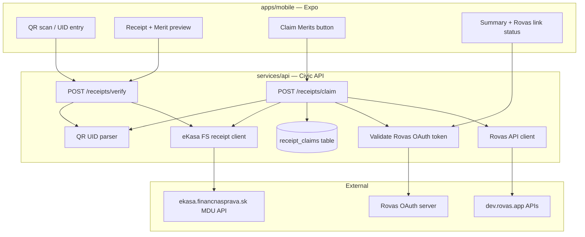
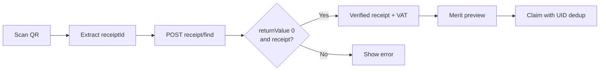
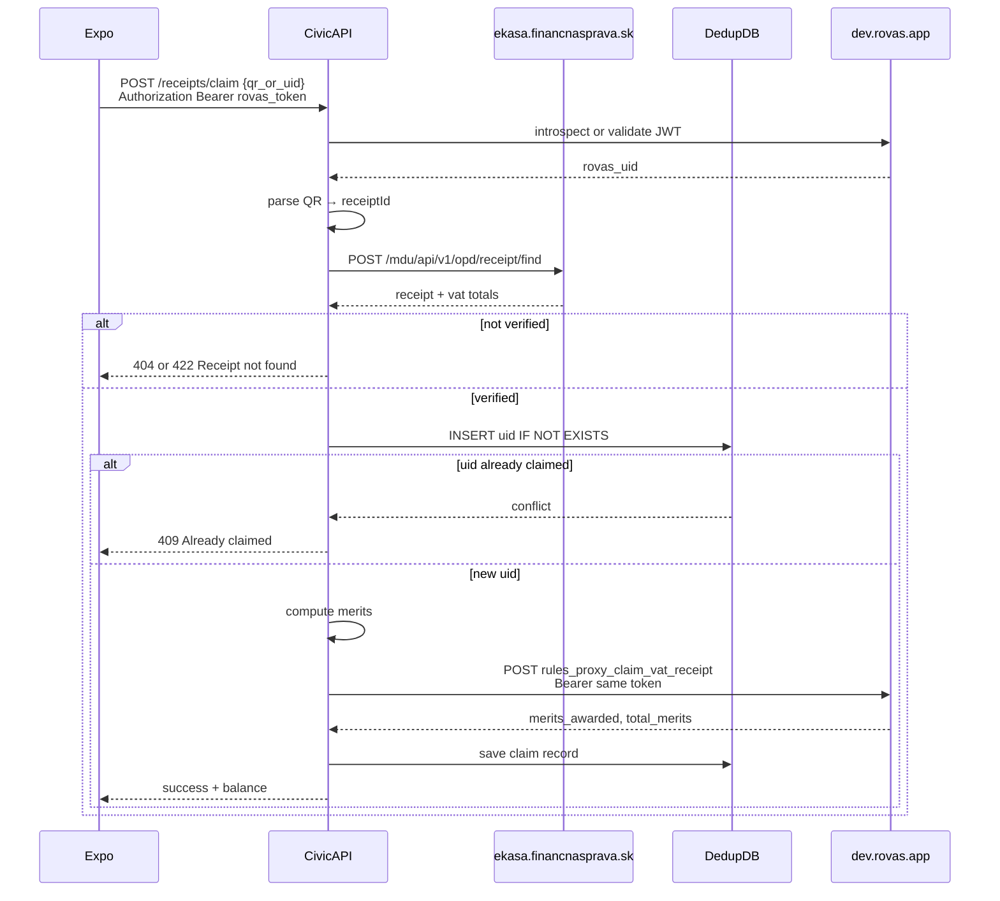
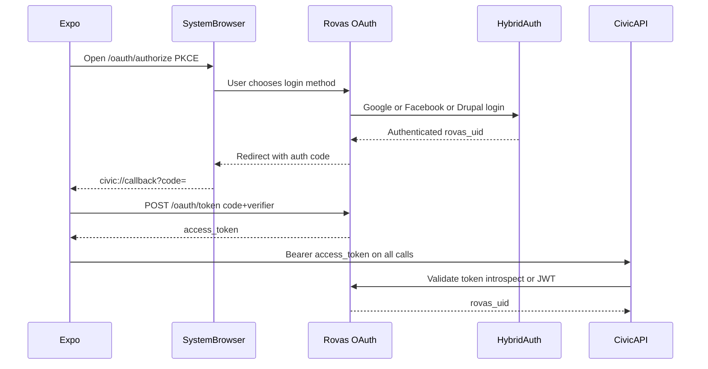

# Civic — Pre-Implementation Plan

**Status:** Planning only — no implementation until approved.

**Project root:** `/Users/sano/Documents/homeProjects/civic`

**Validated assumption:** Scanning a real eKasa receipt QR and calling the FS registry API returns VAT amounts matching the printed slip. A successful API response confirms the receipt is registered with Finančná správa (see §4).

---

## 1. Product goal

Build **Civic**, a Slovak-first mobile app that lets users see and grow their **contribution to society**, expressed in Merits (ME) on their Rovas account. Three Merit-earning paths are surfaced from day one:

1. **Tax payment** — VAT verified via eKasa receipt scan (v1); income tax later
2. **Charitable contribution** — donate to or invest in a Rovas-listed project
3. **Volunteer work** — report hours against a Rovas project

Merits represent labor-hour equivalents (Rovas convention: **10 ME = 1 hour**). Every path converts an act of economic value-surrender into the same Merit unit so a single dashboard can show the user's contribution mix.

**v1 implementation strategy:** the **VAT-receipt path is built end-to-end**. The other two paths (charity, volunteer) plus the investment side-path ship as **navigational stubs that hyperlink to existing Rovas project pages** — so the full information architecture is visible to users while the heavier Rovas-side endpoints (charity list, volunteer-report proxy, ME aggregates) are designed in later phases. See §8 for the screen-by-screen v1 status and §14 for the phase plan.

**Out of scope for v1:**

- Bank account parsing / open banking
- Income tax or payroll withholding
- OCR-only receipts without eKasa QR / UID
- Official Finančná správa endorsement
- Tax refunds or legal tax advice
- Native in-app charity donation flow (v1 hyperlinks to Rovas)
- Native in-app volunteer-report submission (v1 hyperlinks to Rovas)

**Future (not planned here):** donation receipts, eFaktúra B2B (2027+), bank estimates as non-Merit dashboard, in-app investment flow with auto-Merit yield.

---

## 2. System architecture



**Trust boundary:** Users sign in via **Rovas OAuth** (no separate app-specific account). The Expo app stores only a Rovas **access token** (secure storage). Civic API validates that token with Rovas on every request; it never stores per-user API-KEY/TOKEN pairs.

---

## 3. Repository strategy

### Decision (confirmed)

| Piece | Where |
|-------|-------|
| Expo mobile app | **`civic`** monorepo — Cursor project at `~/Documents/homeProjects/civic` |
| Civic API | Same repo (`services/api`) |
| Shared types + Merit math | Same repo (`packages/shared`) |
| Rovas OAuth2 server | **`oauth2_server` contrib** + thin **`rovas_oauth`** custom wrapper |
| Rovas Merit grant rule | Existing **`rovas`** repo only |

**Do not** embed Expo under the Drupal tree. Rovas partner integrations are documented in the sibling repo at `../rovas/sites/all/modules/custom/rovas_api_endpoints/THIRD_PARTY_ACCOUNT_CREATION.md`.

### Monorepo layout

```
~/Documents/homeProjects/civic/          ← this project (Cursor workspace)
├── apps/mobile/          Expo (Expo Router)
│   └── locales/{sk,en}.json    ← Slovak primary (sk), English secondary (en)
├── services/api/         Node + TypeScript (Fastify or Hono)
├── packages/shared/      Types, Merit conversion, QR/UID parsing
├── docs/
│   ├── plan.md           ← this document
│   ├── architecture.md
│   ├── ekasa-receipt-api.md    ← FS lookup contract (spike findings)
│   └── rovas-integration.md
├── identity/             Brand assets (ME_logo.svg, etc.)
├── mocs/                 Mockups (civic-mock.ai, civic-mockup.canvas.tsx)
├── .env.example
├── pnpm-workspace.yaml
└── README.md

~/Documents/homeProjects/rovas/         ← sibling repo; Rovas-side changes only
├── sites/all/modules/contrib/oauth2_server/   ← NEW contrib dependency
├── sites/all/modules/custom/rovas_oauth/    ← thin wrapper (HybridAuth UI, Services Bearer)
├── sites/all/modules/custom/rovas_site_rules/rules/rules_proxy_claim_vat_receipt.json
└── docs/integration/civic.md
```

Optional: multi-root Cursor workspace file linking `civic` and `rovas` when editing Rules + API together.

### Language strategy

| Surface | Primary | Secondary |
|---------|---------|-----------|
| User-facing UI (Expo screens, push, app store listing) | **Slovak (`sk`)** — first target audience | English (`en`) — fallback for non-SK users |
| Code, identifiers, comments, commits, error messages, logs | **English** | — |
| Docs (this plan, ADRs, API specs) | **English** | — |
| User-facing Slack/email support copy | Slovak | English |

i18n implementation: a flat key/value JSON per locale at `apps/mobile/locales/{sk,en}.json` with `en` as the fallback chain. UI strings live behind keys (no hard-coded SK literals in components), so adding more locales later is mechanical. Currency, date, and number formatting use `Intl` with locale `sk-SK` by default.

---

## 4. eKasa verification (QR → FS registry lookup)

Third-party expense apps and the official Over doklad / ePeňaženka apps do **not** read VAT from the QR matrix. They extract the receipt **UID** from the QR, then fetch receipt details from Finančná správa servers. Civic follows the same pattern.

### Consumer surfaces (reference)

| Surface | Status | Notes |
|---------|--------|-------|
| **FS MDU API** | **Works** | Undocumented; powers OPD portal — see below |
| [opd.financnasprava.sk](https://opd.financnasprava.sk/#!/check) | Web UI confusing | Report form UX; underlying API accepts UID-only lookup |
| [overenie.financnasprava.sk](https://overenie.financnasprava.sk/) | **Dead** | Page not found |
| Over doklad / ePeňaženka (official apps) | Works | Same registry backend |
| Merchant eKasa APIs (PortOS/NineDigit) | N/A | Cash-register operators only |

Full API notes: **`docs/ekasa-receipt-api.md`**.

### QR → UID

QR content is the UID string (`O-[A-F0-9]{32}`, case-insensitive) or a URL containing it. Shared parser in `packages/shared`. Manual UID entry fallback on scan failure.

### Registry lookup (verification + VAT)

**Endpoint** (reverse-engineered from OPD portal):

```
POST https://ekasa.financnasprava.sk/mdu/api/v1/opd/receipt/find
Content-Type: application/json
Origin: https://opd.financnasprava.sk
Referer: https://opd.financnasprava.sk/
```

**Request** (online receipt — v1 primary path):

```json
{ "receiptId": "O-7AF0CFF74D45483FB0CFF74D45283FA1" }
```

**Success:** `returnValue === 0` and non-null `receipt` object.

**Verification rule:** a positive response means the receipt **exists in the e-Kasa registry** — the transaction was registered with Finančná správa. Civic treats this as **verified** (same trust level as Over doklad). Only verified receipts proceed to Merit preview and claim.

**VAT for Merits:** derive `vat_eur` from the response — prefer `vatAmountBasic + vatAmountReduced`, or sum `vatSummary[].vatAmount`. Also available: `totalPrice`, `items[]`, `organization.name`, `createDate`, `customerId` (often null).

**Failure:** non-zero `returnValue`, null `receipt`, HTTP/WAF errors, or unknown UID → show error; **no claim**.

### v1 flow



| Case | Identifier | v1 support |
|------|------------|------------|
| Online receipt | `O-` + 32 hex chars | Yes — UID → `receipt/find` |
| Offline receipt | OKP + cash register metadata | Defer to v1.1 (alternate request body) |
| Non-eKasa / invalid QR | — | Show clear error |

### Spike task (before Phase 1 coding)

1. Confirm lookup on 3–5 real receipt UIDs; document in `docs/ekasa-receipt-api.md`.
2. Map `notification` values when `receipt` is null (offline pending, not found, etc.).
3. Confirm VAT recap handling when summary rows are incomplete (FS notice re Jan 2025 DPH rates).
4. Test WAF behaviour from Civic API server IP; document required headers.

### Caveats

- **Undocumented API** — no official developer program; may change or rate-limit without notice.
- **Not buyer-bound** — registry confirms the sale happened, not who paid (§10).
- **Header sensitivity** — bare requests may be WAF-blocked; send `Origin` / `Referer` as OPD portal does.

**Gate:** Phase 1 starts after spike confirms `receipt/find` works for real UIDs and VAT totals are usable.

---

## 5. Merit conversion

Align with Rovas (`hours = merits / 10`):

```
merits = round((vat_eur / hourly_wage_eur) * 10, 2)
```

| Parameter | Source | Notes |
|-----------|--------|-------|
| `vat_eur` | FS `receipt/find` response (`vatAmountBasic + vatAmountReduced` or `vatSummary`) | Registry-verified |
| `hourly_wage_eur` | Config / env | e.g. ŠÚ average gross monthly ÷ 160; document chosen basis |
| `merits_per_hour` | Fixed `10` | Matches Rovas default |

Store `hourly_wage_eur` and `formula_version` on each claim for auditability when the rate changes annually.

**Open decision:** gross vs net hourly wage — pick one before launch and document in app FAQ.

### Display rounding (UI rule)

Storage and the `merits` API field keep two decimal places (`round(..., 2)`) for auditability. The mobile UI **always rounds Merit totals and EUR equivalents to whole numbers** when displaying them on screen (home dashboard, profile, community lookup, receipt history ME column, investment yields, etc.). Show units explicitly (`ME`, `€`) rather than implied; per-receipt VAT amounts in EUR keep their original precision because they are actual payments, not equivalents. Investment yields are presented per-year (whole-number ME) rather than fractional per-month.

---

## 6. Civic API design

**Stack:** Node 20+, TypeScript, Fastify (or Hono), SQLite for MVP (Postgres for production), Zod for validation.

### Endpoints (v1)

| Method | Path | Auth | Purpose |
|--------|------|------|---------|
| POST | `/receipts/verify` | Rovas Bearer optional | Extract UID, call FS `receipt/find`; return verified preview (no grant) |
| POST | `/receipts/claim` | Rovas Bearer required | Verify, dedup, grant Merits via Rovas, persist claim |
| GET | `/users/me/summary` | Rovas Bearer required | Total VAT claimed, total ME, receipt count, Rovas profile hint |
| GET | `/receipts` | Rovas Bearer required | Paginated claim history for authenticated `rovas_uid` |
| GET | `/me/contributions/summary` | Rovas Bearer required | Per-category ME breakdown for screen 0 (taxes, charity, volunteer); v1 reads taxes only — charity/volunteer counts are 0 until those paths ship |
| GET | `/community/contributions/summary` | Public | Aggregate ME totals + per-category breakdown for the logged-out screen 0 |
| GET | `/charities/projects` | Public | Proxies the new Rovas charity-projects endpoint (§7c); query param `?type=charity\|invest` differentiates screens 3 and 5; each item carries a canonical `rovas_url` for v1 hyperlink-out |
| GET | `/rank/distribution` | Public (Rovas Bearer optional) | Proxies the existing **Rovas Merit Distribution** module Services endpoint; returns log-scale buckets `[{ label, count }]` for the histogram on screen 0. With a Bearer token, the response also returns `user_bucket_index` so the mobile app can highlight the caller's bucket and label it with their Rovas username |
| GET | `/users/lookup` | Rovas Bearer required | **Phase 3+ stub** — `?username=<rovas_username>` returns a minimal public profile (`rovas_uid`, `display_name`, totals, percentile) for the Komunita screen. v1 returns 501 Not Implemented |

No local auth endpoints — login happens entirely via Rovas OAuth in the Expo app.

Endpoints marked **stub** in §8 are backed by `/charities/projects`, `/community/contributions/summary`, `/rank/distribution`, and `/users/lookup`. They never write — they only read and forward to Rovas.

### Claim flow (server-side)



### Data model (MVP)

**receipt_claims** — id, receipt_uid (UNIQUE globally), rovas_uid, vat_eur, merits_awarded, merchant_name, purchase_at, hourly_wage_eur, formula_version, buyer_identifier (nullable), payment_method (nullable), fs_verified_at, created_at

**claim_attempts** — id, receipt_uid, rovas_uid, outcome (`claimed` | `duplicate` | `rejected_window` | `rejected_rate` | `error`), created_at — used for strike counting and audit

**user_strikes** — rovas_uid, strike_count, blocked_until (nullable), updated_at — optional; can derive from claim_attempts if preferred

Global UNIQUE on `receipt_uid` prevents double-claim across users. Index on `rovas_uid` for history queries.

No local `users` or `rovas_links` tables — identity comes from the OAuth token.

---

## 7. Rovas integration (rovas repo)

Rovas changes fall into two tracks: **OAuth server** (new, for login) and **Merit grant API** (new rule).

### 7a. Rovas OAuth2 server (oauth2_server contrib)

Rovas today uses HybridAuth only as an **OAuth client** (login via Google, Facebook, Nabezky, etc.). There is **no OAuth server** in the repo yet.

**Decision:** Use the Drupal 7 contrib module **[oauth2_server](https://www.drupal.org/project/oauth2_server)** as the authorization server foundation.

Add a thin custom module **`rovas_oauth`** (depends on `oauth2_server`) for Rovas-specific glue only:

| Responsibility | Module |
|----------------|--------|
| OAuth2 server core, clients, scopes, token storage | **oauth2_server** (contrib) |
| Login UI on authorize page (HybridAuth + Drupal login) | **rovas_oauth** |
| Map Bearer token → `rovas_uid` for Services rules | **rovas_oauth** |
| Export **civic** OAuth client config for dev/prod | **rovas_oauth** (Features or documented manual setup) |

**OAuth client:** Register the **civic** mobile app in oauth2_server admin with:

- Grant type: **Authorization Code** (+ **PKCE** — see caveat below)
- Redirect URIs: `civic://oauth/callback` (production), Expo dev redirect for development
- Scopes: start with module defaults; add custom scope e.g. `merits:claim` if needed
- Public client (no client secret) for mobile

**PKCE caveat (Phase 0 spike):** Tracked in [drupal.org#3015065](https://www.drupal.org/project/oauth2_server/issues/3015065). Spike must confirm PKCE on dev; extend **`rovas_oauth`** if the contrib patch is insufficient.

**Partner API (`rovas_partner_user`)** remains for other integrations, not Civic login.

### 7b. Merit grant and read APIs

| Endpoint | Role |
|----------|------|
| `POST /rovas/rules/rules_user_s_merits` | Read Merit balance (Bearer or API-KEY auth) |
| `rules_give_merits_to_user` | Called inside new claim rule (internal) |

Dev target: **`https://dev.rovas.app`**

### New: `rules_proxy_claim_vat_receipt`

**Logic (summary):**

1. Resolve caller via **OAuth Bearer** (preferred) or legacy API-KEY/TOKEN
2. Reject if `receipt_uid` already in `{civic_claims}` table on Rovas — belt-and-suspenders with API dedup
3. Compute merits; invoke `rules_give_merits_to_user`
4. Return `{ merits_awarded, total_merits, result, result_explain }`

**Expose via Services:** `POST /rovas/rules/rules_proxy_claim_vat_receipt`

**Pointer doc in rovas:** `docs/integration/civic.md`

### Rovas spikes (Phase 0)

- Install **oauth2_server** on dev.rovas.app
- Verify **PKCE** end-to-end (patch #3015065 if needed)
- Register **civic** OAuth client; confirm Authorization Code + PKCE with Expo or curl
- Prototype **rovas_oauth** authorize page with Google + Facebook HybridAuth
- Confirm Bearer token resolves to `rovas_uid` for Services rules

### 7c. Rovas read endpoints used by Civic

Civic's home, earn-hub, and community screens consume read-only signals from Rovas. Some are existing module endpoints we just need to expose / expose-via-Services; others are new and gated behind later phases.

| Endpoint (working name) | Used by (Civic screen) | Returns | Status |
|-------------------------|------------------------|---------|--------|
| `GET /rovas/merit_distribution` | Screen 0 (rank histogram) | Log-scale buckets `[{ label, count }]` for global Merit balance distribution; with auth, includes `user_bucket_index` so the highlighted bar and username label can be drawn | **Existing** — produced by the **Rovas Merit Distribution** module already in production. v1 just needs Services-Bearer auth confirmed and Civic API proxying. |
| `GET /rovas/projects?type=charity` | Screen 3 (Charitatívne projekty) | Project list with `id, title, organization, summary, rovas_url, currency_amount_collected` | Phase 2 stretch |
| `GET /rovas/projects?type=invest` | Screen 5 (Investičné projekty) | Same shape; `expected_yield_me_per_month` extension | Phase 2 stretch |
| `GET /rovas/contributions/aggregate` | Screen 0 logged-out + per-user position calc | `{ total_me, by_category: { taxes, charity, volunteer } }`, plus optional `user_percentile` when called with Bearer | Phase 2 stretch |
| `GET /rovas/users/lookup?username=…` | Screen 6 (Komunita) | Public-profile shape for a Rovas user: `rovas_uid, display_name, total_me, by_category, percentile, public_projects[]`. Honours each Rovas user's privacy preferences. | **Phase 3+** — implemented later, after the broader v1 ships. |
| `POST /rovas/rules/rules_proxy_volunteer_report` | Screen 4 (Dobrovoľnícka práca) | Submits a simplified volunteer report (project, date, hours, description) and returns Merit grant outcome | Phase 3 |

**v1 behaviour:**

- **Screen 0 (rank histogram)** — calls the existing Merit Distribution endpoint via Civic API on day one. This is the only stub-related Rovas endpoint that already exists; no Phase-2 swap needed.
- Screens 3 and 5 render a **statically curated** list (in Civic API config) of 4–6 hand-picked Rovas project URLs and just hyperlink out.
- Screen 0 logged-out shows a placeholder community total (or hides the aggregate block) until the aggregate endpoint lands.
- Screen 4 disables submit and shows a "coming soon" notice with a link to the existing Rovas form.
- **Screen 6 (Komunita)** — disabled search input + skeleton recent-profiles table. Civic API returns `501` for `/users/lookup`. Promoted in Phase 3+ once the Rovas username-lookup endpoint exists.

Promotion path: when each Rovas endpoint ships, swap the corresponding Civic API stub from a static-config response to a live proxy. No Civic mobile changes beyond removing the "stub" badge and enabling disabled controls.

---

## 8. Expo mobile app

### Stack

- **Expo SDK 52+** with Expo Router
- **TypeScript**
- **expo-camera** (barcode scanning)
- **expo-secure-store** for Rovas OAuth tokens
- **expo-auth-session** — Authorization Code + PKCE
- **i18n:** Slovak primary, English secondary

### Screens (v1)

Slovak labels are the user-facing source of truth (see §3 Language strategy). Routes use English identifiers. The interactive mockup of every screen lives at [`mocs/civic-mockup.canvas.tsx`](../mocs/civic-mockup.canvas.tsx); the Cursor IDE picks it up via a symlink in `~/.cursor/projects/.../canvases/`, so edits in either path stay in sync.

| # | Route | Slovak label (UI) | English (dev) | v1 status |
|---|-------|-------------------|---------------|-----------|
| 0 | `/(tabs)/index` | Váš príspevok spoločnosti | Home / contribution dashboard | **Fully built** — logged-in: user ME total (rounded, whole-number) + EUR equivalent + **rank histogram** (sourced from existing Rovas Merit Distribution module, §7c) with the user's bucket highlighted and username labelled + community-position callout (the word "komunite" deep-links to screen 6). Logged-out: aggregate community total + same rank histogram without highlight + sign-in/register CTAs. |
| 1 | `/(tabs)/earn` | Získať merity | Earn hub | **Fully built** — three numbered cards routing to children |
| 2 | `/(tabs)/earn/receipts` | Bločky | Receipts | **Fully built** — eKasa scan + claim history (the §4 / §6 receipt flow lives here) |
| 3 | `/(tabs)/earn/charity` | Charitatívne projekty | Charity projects | **Stub** — list backed by `/charities/projects?type=charity`; each item hyperlinks to `rovas.app/project/<id>` |
| 4 | `/(tabs)/earn/volunteer` | Dobrovoľnícka práca | Volunteer report | **Stub** — form skeleton mirroring the simplified Rovas form; submit disabled with "coming soon" until §7c proxy ships |
| 5 | `/(tabs)/earn/invest` | Investičné projekty | Investment projects | **Stub** — list backed by `/charities/projects?type=invest`; each item hyperlinks to `rovas.app/project/<id>` |
| 6 | `/(tabs)/community` | Komunita | Community / user lookup by Rovas username | **Stub** — disabled search input + skeleton recents table; promoted in Phase 3+ once `/users/lookup` (§7c) ships |
| — | `/(auth)/login` | Prihlásenie | Login | **Fully built** — Rovas OAuth (Google / Facebook / Rovas) |
| — | `/(auth)/register` | Registrácia | Registration | **Fully built** — same OAuth providers, framed for first-time users; HybridAuth auto-creates the Rovas account |
| — | `/(tabs)/profile` | Profil | Profile | **Fully built** — Rovas user info, Merit balance, sign out |

The earn-hub child routes (`/earn/receipts`, `/earn/charity`, `/earn/volunteer`, `/earn/invest`) are reached from screen 1's primary CTAs and from the inter-screen links shown in the canvas mockup. Screen 0 surfaces a single primary CTA — "Získať merity" — that routes to screen 1, and inline links such as "komunite" inside the **Vaša pozícia v komunite** callout deep-link to screen 6.

**Navigation TODO:** v1 reaches every screen via inline CTAs and Rovas hyperlinks. As the IA grows past ~6 screens we expect to introduce a **proper navigation menu** — most likely a bottom-tab bar (Domov / Získať / Bločky / Komunita / Profil) with the earn-hub children promoted to a stack inside the "Získať" tab. Track this when the screen count or session-length data justifies it; not part of v1 scope.

### App identifiers

- OAuth redirect scheme: **`civic://oauth/callback`**
- Expo `slug` / package name: **`civic`** (finalize in `app.json` at scaffold time)

---

## 9. Authentication model

**No separate app account.** User identity is the **Rovas user** established through OAuth.



---

## 10. Receipt fraud mitigation

**Threat:** Anyone can pick up a discarded receipt, scan the QR, and claim Merits they did not earn. eKasa receipts are **not inherently buyer-bound** — registry verification proves a sale happened, not who paid.

### What FS verification exposes

| Field | Source | Useful for buyer binding? |
|-------|--------|---------------------------|
| Receipt UID (`O-…`) | QR + FS response | Dedup only |
| VAT total | FS `receipt/find` | Registry-verified |
| Date/time, merchant | FS response | Heuristics only |
| Payment method | FS `receipt.payments` when present | **No** — not linked to a person |
| **customerId** | FS response when buyer ID provided at sale | **Yes when present**, rare in retail |

Phase 0 spike must record which payment/buyer fields appear in FS JSON.

### Tier 1 — v1 mandatory

- **Global UID dedup** — first claim wins; others get `409`
- **claim_attempts** log for every duplicate try
- **3-strike policy:** 3 duplicate attempts in 30 days → temporary claim block (no Merit deduction in v1)

### Tier 2 — v1 recommended

- **30-day claim window** from receipt timestamp
- Rate limits (e.g. 20/day, 200/month)
- Minimum Rovas account age (24h)
- Monthly Merit cap

### Tier 3 — v1.1 if spike confirms buyer ID

- Bind claims to `customerId` when present on FS response

### Tier 4 — deferred

Bank/card matching, geolocation, photo proof, e-receipt to verified email (v2).

### Testing fraud controls

- [ ] User A claims UID → success; user B → 409
- [ ] User B × 3 duplicates → block
- [ ] Receipt older than window → rejected
- [ ] Daily rate exceeded → rejected

---

## 11. Security and privacy

| Risk | Mitigation |
|------|------------|
| OAuth token theft | PKCE, secure-store, short-lived tokens |
| Trashcan receipt fraud | §10 dedup, strikes, window, rate limits |
| Fake receipts | FS `receipt/find` must return verified receipt before claim |
| Merit farming | Monthly cap; server-side VAT-only computation from FS response |
| GDPR | Claims keyed by `rovas_uid`; privacy policy |

---

## 12. Testing strategy

- [x] FS `receipt/find` returns VAT for sample UID
- [ ] API verify same UID → VAT matches printed receipt
- [ ] Unregistered / fake UID → rejected (no claim)
- [ ] Duplicate claim returns 409
- [ ] Rovas OAuth PKCE on dev.rovas.app
- [ ] Phase 1: scan → preview on device
- [ ] Phase 2: claim increases Merit balance
- [ ] Phase 3: TestFlight / internal APK in real shop lighting

---

## 13. Deployment (high level)

| Component | MVP | Production |
|-----------|-----|------------|
| Civic API | localhost + Expo dev client | VPS subdomain (e.g. `api.civic.example.sk`) |
| Database | SQLite | Postgres |
| Expo | Expo Go | EAS → TestFlight / Play internal |
| Rovas | dev.rovas.app | rovas.app |

---

## 14. Phased delivery

### Phase 0 — Spikes + mockup approval

- FS `receipt/find` contract documented (`docs/ekasa-receipt-api.md`)
- Rovas OAuth + PKCE on dev; register **civic** client
- Hourly wage source chosen
- 6-screen mockup reviewed against the user-supplied Slovak outline (`mocs/civic-mockup.canvas.tsx`)

**Exit gate:** Receipt UID verifies via `receipt/find`; OAuth returns usable Bearer token; mockup signed off.

### Phase 1 — Navigational shell + verify-preview

- Scaffold **civic** monorepo and locale files (`sk` primary, `en` fallback)
- All 6 screens from §8 ship in the Expo app:
  - Screens 0, 1, 2 are fully built against live data
  - Screens 3, 4, 5 ship as **stubs** with the static curated project list (§7c) and the disabled volunteer form
- API: `/receipts/verify`, `/me/contributions/summary` (taxes-only), `/community/contributions/summary` (placeholder), `/charities/projects` (static config)
- No claim or OAuth yet — preview only

### Phase 2 — Rovas Merits + OAuth

- OAuth server, claim rule, fraud controls, Expo login + claim
- `/me/contributions/summary` reads real Merit history per category
- **Stretch:** if the new Rovas read endpoints from §7c land, swap `/charities/projects` and `/community/contributions/summary` from static config to live proxies

### Phase 3 — Polish + stores + stub promotion

- SK i18n polish, API deploy, EAS builds
- Promote stubs to first-class flows as Rovas endpoints land (volunteer-report proxy first; in-app charity / invest flows when product is ready)

---

## 15. What we defer

- Bank/card matching, offline OKP receipts, buyer-ID binding until spike confirms fields
- Auto-deduct Merits as fraud punishment, slovensko.sk login, Merit leaderboard in app

---

## 16. Approval checklist

1. Plan scope approved
2. Hourly wage basis for Merit formula
3. OAuth providers: Google + Facebook + Drupal login
4. FS lookup via undocumented `receipt/find` API — acceptable for v1 (see §4)
5. Fraud defaults: 30d window, daily limits, 3-strike block duration
6. Three-path framing approved — receipts only fully built in v1; charity / volunteer / invest ship as Rovas-hyperlink stubs (§7c, §8)
7. Slovak primary / English secondary i18n strategy approved (§3 Language strategy)
8. 6-screen mockup at `mocs/civic-mockup.canvas.tsx` reviewed and signed off

---

## Summary

| Layer | Technology | Location |
|-------|------------|----------|
| Mobile | Expo + expo-auth-session | `civic/apps/mobile` |
| Backend | Node + TS API | `civic/services/api` |
| Shared | Types + Merit math | `civic/packages/shared` |
| Identity | oauth2_server + rovas_oauth | `rovas` repo |
| Ledger | Rovas Rules + Merits | `rovas` repo |

**Next step after approval:** Phase 0 spikes, then scaffold the **civic** monorepo.
